<a name="readme-top"></a>

<div align="center">

<h1><picture><source media="(prefers-color-scheme: dark)" srcset="assets/logo-dark.svg"></picture> agentic-dom</h1>

<h3>Stop making AI agents guess.</h3>

Your frontend is an interface for AI agents too. agentic-dom is an ESLint plugin that catches the React code they can't operate, and tells your coding agent what to add.

[](https://github.com/caiodsc/agentic-dom/actions/workflows/test.yml)
[](LICENSE)
[](#quick-start)

**[Quick start](#quick-start) · [How it works](#how-it-works) · [See it in action](#see-it-in-action) · [Rules](#rules) · [Setup](#setup) · [For agents](#for-agents)**

<br>

**What an AI agent reads on your page**

<picture>
  <source media="(prefers-color-scheme: dark)" srcset="assets/hero-dark.svg">
  
</picture>

<sub>Computed by rendering the components in <a href="#see-it-in-action">See it in action</a>, not mocked.</sub>

</div>

<br>

## Principles

1. **Quiet when unsure.** A rule reports only what it can tell from the code with confidence, because a warning you learn to ignore is worse than a missed case.
2. **Built for agents.** Every rule targets something an AI agent gets stuck on, not every accessibility issue.
3. **Reasons about JSX values.** The rules trace each value through the code without running it, and a value React renders as nothing, like `false` or `""`, counts as missing.
4. **Standard fixes.** Every message asks for plain HTML or ARIA: a `<label>`, `aria-labelledby`, `aria-describedby`, `aria-label`, `aria-expanded`, `aria-pressed`, `aria-checked` or `aria-selected`. A weaker way to say the same thing never passes, even when that means more warnings. A `title` is one. It shows on screen only on hover, and the browser uses it as the name only when nothing else names the element.
5. **Limits written down.** Each rule page lists what it skips on purpose under "Not reported", and a skipped case stays skipped until that list changes first.

<br>

## Quick start

```sh
npm install -D eslint-plugin-agentic-dom
```

```js
// eslint.config.js
import agenticDom from "eslint-plugin-agentic-dom";

export default [
  agenticDom.configs.recommended,
];
```

Then run `npx eslint .` and hand the messages to your coding agent. Using TypeScript? See [Setup](#setup).

<picture>
  <source media="(prefers-color-scheme: dark)" srcset="assets/terminal-dark.svg">
  
</picture>

<br>

## Why agentic-dom

Browser agents like Claude in Chrome and Playwright MCP read a page through its accessibility tree, often alongside screenshots. A label that is only nearby text, a disabled button with no reason, or a column of identical "Edit" buttons looks fine to a person. To an agent it is a field with no name, a dead button, or a guess. agentic-dom catches those patterns in your JSX. The [Rules](#rules) table has the exact list.

Each message says what an agent sees and what to add, so the coding agent that wrote the component can fix it too.

<br>

## How it works

<picture>
  <source media="(prefers-color-scheme: dark)" srcset="assets/flow-dark.svg">
  
</picture>

<br>

## See it in action

**1. A button with only an icon** (Flagged by [`icon-button-has-name`](docs/rules/icon-button-has-name.md))

```jsx
// ❌ Before. Agent reads: button → "What does this button do?"
const DeleteButton = ({ onDelete }) => (
  <button onClick={onDelete}>
    <TrashIcon />
  </button>
);

// ✅ After. Agent reads: button "Delete" → "The delete button."
const DeleteButton = ({ onDelete }) => (
  <button onClick={onDelete} aria-label="Delete">
    <TrashIcon />
  </button>
);
```

<br>

**2. A disabled button with no reason** (Flagged by [`disabled-has-reason`](docs/rules/disabled-has-reason.md))

```jsx
// ❌ Before. Agent reads: button "Pay", disabled, no description → "Why can't I pay?"
const PayButton = ({ hasCard }) => (
  <button disabled={!hasCard}>Pay</button>
);

// ✅ After. Agent reads: button "Pay", disabled · "Add a card to pay." → "Add a card first."
const PayButton = ({ hasCard }) => (
  <>
    <button disabled={!hasCard} aria-describedby="why">
      Pay
    </button>
    {!hasCard && <p id="why">Add a card to pay.</p>}
  </>
);
```

<br>

**3. The same button on every row** (Flagged by [`repeated-action-context`](docs/rules/repeated-action-context.md))

```jsx
// ❌ Before. Agent reads: button "Edit", "Edit", "Edit" → "Which one is Ben's?"
const TeamList = ({ users }) =>
  users.map((user) => (
    <li key={user.id}>
      {user.name} <button>Edit</button>
    </li>
  ));

// ✅ After. Agent reads: button "Edit Ana", "Edit Ben", "Edit Carl" → "Edit Ben".
const TeamList = ({ users }) =>
  users.map((user) => (
    <li key={user.id}>
      {user.name}
      <button aria-label={`Edit ${user.name}`}>
        Edit
      </button>
    </li>
  ));
```

<br>

## Rules

| # | Rule | What it flags | Recommended |
|---|---|---|---|
| 1 | [label-prop-linked](docs/rules/label-prop-linked.md) | A component shows its `label` prop but never links it to its control | error |
| 2 | [icon-button-has-name](docs/rules/icon-button-has-name.md) | A button that shows only an icon and has no name | error |
| 3 | [disabled-has-reason](docs/rules/disabled-has-reason.md) | A button can be disabled without saying why | warn |
| 4 | [repeated-action-context](docs/rules/repeated-action-context.md) | The same button or link name on every row of a list | warn |
| 5 | [error-prop-linked](docs/rules/error-prop-linked.md) | A component shows its `error` prop but never links it to its control | warn |
| 6 | [toggle-has-state](docs/rules/toggle-has-state.md) | A button shows and hides content but never says whether it is shown | warn |
| 7 | [selected-has-state](docs/rules/selected-has-state.md) | A button looks selected but never says whether it is selected | warn |

<br>

## Setup

**Your components.** The rules treat components whose name ends in `Button` as buttons and in `Link` as links, and read their name from their text or `aria-label`. Map anything else in settings. A component that builds its name from other props can be mapped to `as: "none"` to skip it:

```js
{
  settings: {
    "agentic-dom": {
      components: {
        Action: { as: "button" },
        NavItem: { as: "link" },
        TooltipButton: { as: "none" },
      },
    },
  },
}
```

**TypeScript.** TypeScript files need a TypeScript parser in the same config:

```js
import tsParser from "@typescript-eslint/parser";

export default [
  { files: ["**/*.{ts,tsx,mts,cts}"], languageOptions: { parser: tsParser } },
  agenticDom.configs.recommended,
];
```

**ESLint 8 with `.eslintrc`.** Extend the legacy config instead:

```json
{
  "extends": ["plugin:agentic-dom/legacy-recommended"]
}
```

**Existing code.** Adopt the rules on a large codebase without fixing everything first, using ESLint's bulk suppressions (ESLint 9.24 or newer):

```sh
npx eslint . --suppress-all
```

New code is checked. Old violations stay listed in `eslint-suppressions.json` until someone fixes them.

<br>

## For agents

Paste this prompt into your coding agent.

```text
Add eslint-plugin-agentic-dom to this project's ESLint setup, following the Quick start and Setup sections of https://github.com/caiodsc/agentic-dom#readme. Keep every existing config entry, and map our own button and link components.

Then run ESLint and fix every agentic-dom message. If there are too many, suppress them as the README says and tell me how many.
```

<br>

## Contributing

Found a wrong report or have a rule idea? [Open an issue](https://github.com/caiodsc/agentic-dom/issues/new/choose). To send a change, see [CONTRIBUTING.md](CONTRIBUTING.md).

<br>

## License

[MIT](LICENSE). This project is not affiliated with any other project or website.

<br>

<div align="center">

If agentic-dom saved your agent a guess, a ⭐ helps others find it.

<a href="#readme-top"><picture><source media="(prefers-color-scheme: dark)" srcset="assets/top-dark.svg"></picture></a>

</div>
