<a name="readme-top"></a>

<div align="center">

<h1><picture><source media="(prefers-color-scheme: dark)" srcset="assets/logo-dark.svg"></picture> agent-ready</h1>

<h3>Stop making AI agents guess.</h3>

Your frontend is an interface for AI agents too. agent-ready is an ESLint plugin that catches the React code they can't operate, and tells your coding agent what to add.

[](https://github.com/caiodsc/agent-ready/actions/workflows/test.yml)
[](LICENSE)
[](#quick-start)

**[Quick start](#quick-start) · [How it works](#how-it-works) · [See it in action](#see-it-in-action) · [Rules](#rules) · [Setup](#setup)**

<br>

**What an AI agent reads on your page**

<picture>
  <source media="(prefers-color-scheme: dark)" srcset="assets/hero-dark.svg">
  
</picture>

<sub>Computed by rendering the components in <a href="#see-it-in-action">See it in action</a>, not mocked.</sub>

</div>

<br>

## Quick start

```sh
npm install -D eslint-plugin-agent-ready
```

```js
// eslint.config.js
import agentReady from "eslint-plugin-agent-ready";

export default [
  agentReady.configs.recommended,
];
```

Then run `npx eslint .` and hand the messages to your coding agent. Using TypeScript? See [Setup](#setup).

<picture>
  <source media="(prefers-color-scheme: dark)" srcset="assets/terminal-dark.svg">
  
</picture>

<br>

## Why agent-ready

Browser agents like Claude in Chrome and Playwright MCP read a page through its accessibility tree, not its pixels. A label that is only nearby text, a disabled button with no reason, or a column of identical "Edit" buttons looks fine to a person. To an agent it is a field with no name, a dead button, or a guess. agent-ready catches those patterns in your JSX. The [Rules](#rules) table has the exact list.

Each message says what an agent sees and what to add, so the coding agent that wrote the component can fix it too. The rules read the JSX as written, so a button name that only exists at runtime is not checked.

<br>

## How it works

<picture>
  <source media="(prefers-color-scheme: dark)" srcset="assets/flow-dark.svg">
  
</picture>

<br>

## See it in action

**A field with no name**

```jsx
// ❌ Before. Agent reads: textbox
// Which field is this?
const Field = ({ label }) => (
  <>
    <span>{label}</span>
    <input />
  </>
);

// ✅ After. Agent reads: textbox "Email"
// The email field.
const Field = ({ label }) => {
  const id = useId();
  return (
    <>
      <label htmlFor={id}>{label}</label>
      <input id={id} />
    </>
  );
};
```

Flagged by [`label-prop-linked`](docs/rules/label-prop-linked.md). Rendered with `label="Email"`.

<br>

**A disabled button with no reason**

```jsx
// ❌ Before. Agent reads: button "Pay", disabled, no description
// Why can't I pay?
const PayButton = ({ hasCard }) => (
  <button disabled={!hasCard}>Pay</button>
);

// ✅ After. Agent reads: button "Pay", disabled, described as "Add a card to pay."
// Add a card first.
const PayButton = ({ hasCard }) => (
  <>
    <button disabled={!hasCard} aria-describedby="why">
      Pay
    </button>
    {!hasCard && <p id="why">Add a card to pay.</p>}
  </>
);
```

Flagged by [`disabled-has-reason`](docs/rules/disabled-has-reason.md).

<br>

**The same button on every row**

```jsx
// ❌ Before. Agent reads: button "Edit", button "Edit", button "Edit"
// Which one is Ben's?
const TeamList = ({ users }) =>
  users.map((user) => (
    <li key={user.id}>
      {user.name} <button>Edit</button>
    </li>
  ));

// ✅ After. Agent reads: button "Edit Ana", button "Edit Ben", button "Edit Carl"
// "Edit Ben".
const TeamList = ({ users }) =>
  users.map((user) => (
    <li key={user.id}>
      {user.name}
      <button aria-label={`Edit ${user.name}`}>
        Edit
      </button>
    </li>
  ));
```

Flagged by [`repeated-action-context`](docs/rules/repeated-action-context.md).

<br>

## Rules

| Rule | What it flags | Recommended |
|---|---|---|
| [disabled-has-reason](docs/rules/disabled-has-reason.md) | A button can be disabled without saying why | warn |
| [label-prop-linked](docs/rules/label-prop-linked.md) | A component shows its `label` prop but never links it to its control | error |
| [repeated-action-context](docs/rules/repeated-action-context.md) | The same button or link name on every row of a list | warn |

<br>

## Setup

**Your components.** The rules treat components whose name ends in `Button` as buttons and in `Link` as links. Map anything else in settings:

```js
{
  settings: {
    "agent-ready": {
      components: {
        Action: { as: "button" },
        NavItem: { as: "link" },
      },
    },
  },
}
```

**TypeScript.** TypeScript files need a TypeScript parser in the same config:

```js
import tsParser from "@typescript-eslint/parser";

export default [
  { files: ["**/*.{ts,tsx,mts,cts}"], languageOptions: { parser: tsParser } },
  agentReady.configs.recommended,
];
```

**Existing code.** Adopt the rules on a large codebase without fixing everything first, using ESLint's bulk suppressions:

```sh
npx eslint . --suppress-all
```

New code is checked. Old violations stay listed in `eslint-suppressions.json` until someone fixes them.

<br>

## License

[MIT](LICENSE). This project is not affiliated with any other project or website.

<br>

<div align="center">

If agent-ready saved your agent a guess, a ⭐ helps others find it.

<a href="#readme-top"><picture><source media="(prefers-color-scheme: dark)" srcset="assets/top-dark.svg"></picture></a>

</div>
